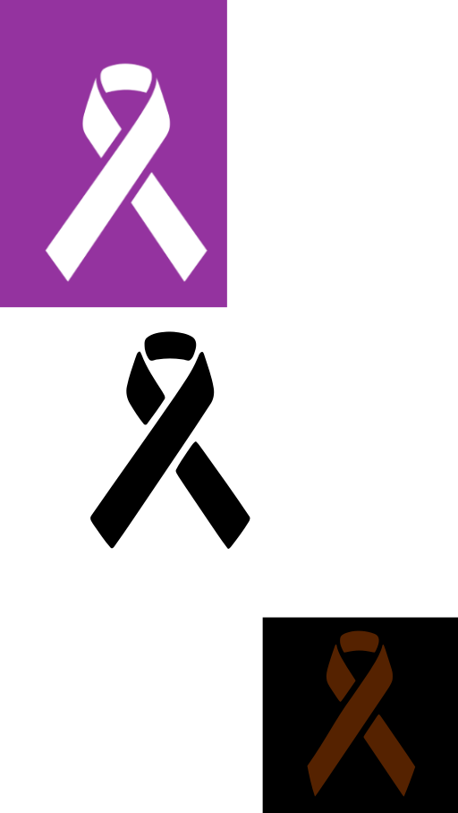

# Brown Ribbon · Nastro marrone

**Italiano.** Il nastro marrone è un segno di dissenso pacifico per la rimozione dei contenuti scat da ThisVid e di vicinanza alla comunità che lì aveva trovato un punto d’incontro. Puoi scaricare l’immagine e usarla sul tuo profilo per mostrare solidarietà.

**English.** The brown ribbon is a quiet protest against the removal of scat content from ThisVid and a sign of solidarity with the community that found a place to connect there. You can download the image and use it on your profile to show your support.

[Scarica il PNG / Download the PNG](../../releases/download/v1.0.0/brown-ribbon.png)
